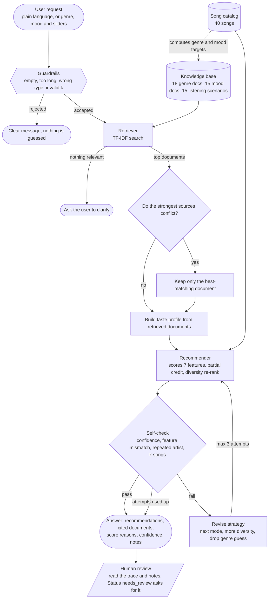

# 🎵 VibeFinder 2.0: Ask-in-Plain-Words Music Recommender

VibeFinder turns a sentence like *"something calm to study to late at night"* into a ranked, explained list of songs. It retrieves matching knowledge (genre, mood and listening-situation descriptions), builds a taste profile from what it retrieved, scores a song catalog, **checks its own result**, revises if the check fails, and shows every step it took.

## Original project

This is an extension of my **Module 3 project, the Music Recommender Simulation (VibeFinder 1.0)**. Version 1.0 read a 20-song CSV, compared each song to a hand-written taste profile (favorite genre, favorite mood, target energy), and printed the top 5 with a reason for each score. It used exact label matching and ignored tempo, valence, danceability, and acousticness. Its own model card listed these weaknesses, and 2.0 addresses them.

## Why it matters

A recommender that returns a list without saying how sure it is, or what it based the list on, cannot be trusted or debugged. VibeFinder 2.0 is built around three habits: show the evidence (retrieved documents and per-feature score reasons), check the result before presenting it, and say so when it is guessing or when the request contradicts itself.

---

## Architecture overview

The diagram source is in [diagrams/architecture.mmd](diagrams/architecture.mmd).



**How data flows.** A request is checked by the guardrails, then the **retriever** searches a knowledge base of 48 documents. The retrieved documents *build* the taste profile: genre and mood come from weighted votes, and numeric targets (energy, valence, danceability, acousticness, tempo) are relevance-weighted averages of the documents' targets. Different requests therefore produce different profiles and different lists. The **recommender** scores all 40 songs against the profile. The **self-check** tests the result; if it fails, the agent tries the next strategy (up to 3 attempts) and keeps the best attempt. If retrieval finds nothing relevant, the agent asks for clarification instead of guessing. If the strongest sources disagree (for example "calm" plus "workout"), it follows only the best match and flags the result for human review.

**Where humans and tests check the system.** A person reads the trace and notes (and `needs_review` asks for that). The 73 automated tests, the two evaluation scripts, and my hand-labelled relevant songs and documents act as external checks.

### Components

| File | Role |
|---|---|
| `src/retriever.py` | Loads the knowledge base and runs TF-IDF retrieval (pure Python, no API key) |
| `src/agent.py` | Guardrails, retrieval, profile building, check and revise loop, answer text |
| `src/recommender.py` | Scoring (7 features), 5 modes, partial credit, diversity, confidence, validation |
| `src/log_setup.py` | Logging to `logs/vibefinder.log` |
| `src/evaluate_agent.py` | Retrieval, paraphrase, conflict and guardrail evaluation |
| `src/evaluate.py`, `src/profiles.py` | Version 1 vs 2 comparison with hand-labelled relevant songs |
| `src/main.py` | CLI for the profile-based recommender |
| `app.py` | Streamlit app: "Ask in plain words" tab and "Pick your taste" tab |
| `data/songs.csv`, `data/knowledge_base.json` | 40 songs, 18 genre + 15 mood + 15 scenario documents |

---

## Setup instructions

Requires Python 3.10 or newer. Nothing needs an account, API key, or internet connection.

```bash
git clone https://github.com/FantasyGodX/AI110-final_proj.git
cd AI110-final_proj
python -m venv .venv
.venv\Scripts\activate            # Windows   (source .venv/bin/activate on Mac/Linux)
pip install -r requirements.txt
pytest                            # expect: 73 passed
```

| Task | Command |
|---|---|
| Ask in plain words | `python -m src.agent "something calm to study to late at night"` |
| Same, without the trace | `python -m src.agent "gym workout music" --no-trace` |
| Web app | `streamlit run app.py` |
| Run all 10 profiles (v2) | `python -m src.main` |
| Reproduce v1 behavior | `python -m src.main --mode classic` |
| Evaluate retrieval, agent, guardrails | `python -m src.evaluate_agent --write assets/evaluation_results.md` |
| Compare v1 and v2 | `python -m src.evaluate --per-profile` |

Exit codes for `src.agent`: 0 = recommendations returned, 2 = request rejected or needs clarification, 1 = data files could not be loaded. Every step is appended to `logs/vibefinder.log`.

---

## Sample interactions

Full captured output is in [assets/sample_runs.md](assets/sample_runs.md) (reproducible with the commands shown there). Excerpts:

**1. A normal request. The check fails once, the agent revises, then it passes.**

```text
$ python -m src.agent "something calm to study to late at night"
Status: ok
For "something calm to study to late at night" I retrieved 'Studying' (scenario), 'Relaxed' (mood), 'Meditation and yoga' (scenario). From that I aimed for genre 'ambient', mood 'focused', energy around 0.30, tempo near 74 BPM. My top pick is 'Focus Flow' by LoRoom. Confidence: high (92%).

Agent trace:
  [guard] accepted query (40 chars): 'something calm to study to late at night'
  [retrieve] scenario:study (0.42); mood:relaxed (0.24); scenario:meditation (0.15)
  [profile] built from retrieved documents: {'genre': 'ambient', 'mood': 'focused', 'energy': 0.3, 'valence': 0.57, 'danceability': 0.6, 'acousticness': 0.79, 'tempo_bpm': 74}
  [attempt 1] mode=balanced diversity=0.1 genre=kept -> confidence high (86%); failed: no repeated artist
  [revise] trying a different strategy because: no repeated artist
  [attempt 2] mode=vibe_first diversity=0.15 genre=kept -> confidence high (92%); all checks passed
  [final] chose attempt 2 (vibe_first); status=ok

1. Focus Flow by LoRoom  [lofi/focused]  score 6.47 / 7.00
     supported by retrieved: Studying
2. Spacewalk Thoughts by Orbit Bloom  [ambient/chill]  score 5.94 / 7.00
     supported by retrieved: Studying, Meditation and yoga
```

**2. A contradictory request. The agent notices and flags it instead of averaging it away.**

```text
$ python -m src.agent "calm and peaceful but also super high energy workout"
Status: needs_review
  [retrieve] mood:serene (0.23); scenario:workout (0.22); mood:relaxed (0.20)
  [conflict] the request mixes conflicting signals: 'Serene' targets energy 0.21 but 'Workout' targets 0.92; using only the best match 'Serene'
1. Daybreak Choir by Orbit Bloom  [ambient/serene]  score 4.41 / 4.50
Note: the request mixes conflicting signals: 'Serene' targets energy 0.21 but 'Workout' targets 0.92; I followed 'Serene' and ignored the rest
```

**3. Input it cannot use. It asks instead of guessing.**

```text
$ python -m src.agent "asdfgh qwerty zxcv"
Status: needs_clarification
I could not match that to any genre, mood, or listening situation. Try describing an activity (studying, workout, road trip), a mood (sad, happy, calm), or a genre (jazz, lofi, k-pop).

$ python -m src.agent ""
Status: rejected
Request rejected: the request is empty; describe what you want to listen to.
```

---

## Design decisions and trade-offs

- **Retrieval builds the profile, not just decorates the answer.** The profile's genre, mood, and numeric targets are computed from the retrieved documents. A test confirms "study" and "workout" produce different profiles and non-overlapping lists.
- **Pure-Python TF-IDF instead of a hosted model or embeddings.** It runs offline, needs no key, and gives identical results on every run, which makes the evaluation reproducible. The cost: it only matches words it has seen. "Música para estudiar" gets a clarification request, and "ocean waves" missed the beach document. A real deployment would likely use embeddings.
- **Genre and mood targets come from the catalog; scenario targets are my judgment.** That keeps genre numbers honest, but the 15 scenarios (for example "study = energy 0.30") are my opinion.
- **Self-check with bounded revision.** The agent tries at most 3 strategies and keeps the best, so it can never loop forever. Checks: confidence at least medium, no big feature mismatch on the top pick, no repeated artist, and k songs returned.
- **I changed a parameter after seeing the evaluation.** The first attempt originally used diversity 0.05, and the "no repeated artist" check failed on 17 of 20 queries, so "revision" was mostly a diversity bump. I raised the starting value to 0.10. It still triggers on 12 of 20 queries, so the revision loop is real but is mostly a diversity retry on ordinary requests.
- **Conflict detection fails safe, not smart.** When sources disagree, the agent follows the best-scoring document and sets `needs_review`. With a near-tie it is effectively arbitrary, which is why it asks a human to look.
- **Kept `classic` mode** so version 1 behavior can be reproduced and compared. It reproduces every 1.0 score exactly on the original 20 songs.
- **Catalog doubled to 40 songs.** This turned out to be the biggest single quality gain (see Testing).

---

## Testing summary

**73 automated tests pass** (6 from version 1, 30 for the 2.0 scoring, 37 for retrieval, the agent, guardrails, and logging). Output: [assets/test_output.txt](assets/test_output.txt).

Structured experiments, generated by `python -m src.evaluate_agent` ([assets/evaluation_results.md](assets/evaluation_results.md)):

| Experiment | Result |
|---|---|
| Retrieval accuracy (20 queries, labels written by me) | Top-1 **90%** (18/20), top-3 **100%** (20/20) |
| Paraphrase stability (4 groups x 3 wordings) | Mean top-5 overlap **0.84**. Study and workout 1.00, sleep 0.78, party 0.59 |
| Repeatability (same query 5 times) | Identical every time |
| Agent on the 20 queries | 19 `ok`, 1 `needs_review` (a false alarm), 12 revised and all 12 recovered |
| Contradictory requests (4) | **4/4** flagged `needs_review` |
| Guardrails (12 bad inputs) | **12/12** handled without a crash |

Version 1 vs 2 on 10 profiles ([assets/v1_vs_v2_evaluation.txt](assets/v1_vs_v2_evaluation.txt)): precision@5 went from 0.54 (v1, 20 songs) to 0.70 (v1, 40 songs) to 0.72 (balanced). **Most of the gain came from the bigger catalog, not the new scoring (+0.02).**

**What worked:** retrieval on clear requests, guardrails, conflict detection, and the visible trace.

**What did not:**
- Two retrieval misses: "driving across the country" matched the *country* genre, and "sunshine and ocean waves" matched reggae before beach.
- One false conflict flag: "taking the train to work" matched the workout document because "train" and "training" share a stem.
- Paraphrase stability on "party" is only 0.59.
- **Confidence is not discriminating.** All 20 queries scored "high". It measures fit to the profile the agent built, not to what you meant, so a flagged conflicting request can still read "high (98%)". The `needs_review` status carries the warning, not the confidence number.

**What I learned:** the test I trusted least (the evaluation) taught me the most. It showed that a check failing 85% of the time was a miscalibrated default, that contradiction was being silently averaged away, and that the catalog size mattered more than the clever rules.

Limits of the evaluation: I wrote the queries, the "right document" labels, and the contradictory examples, and the contradictory examples were written after I understood how the detector works. Twenty queries is small.

---

## Reflection

Building this taught me that the hard part of a reliable system is not producing an answer but deciding when not to trust it. Retrieval made the system's inputs inspectable, the check-and-revise loop made its output testable, and the evaluation showed me where my own assumptions were wrong. The full reflection (limitations, misuse, surprises, and collaboration) is in [model_card.md](model_card.md).

## Project files

```
app.py                        Streamlit app
data/songs.csv                40-song catalog
data/knowledge_base.json      genre, mood and scenario documents
diagrams/architecture.mmd     system diagram (Mermaid source)
assets/                       captured outputs: sample runs, tests, evaluations, log
src/                          retriever, agent, recommender, evaluation, logging, CLI
tests/                        73 tests
model_card.md                 intended use, evaluation, limitations, ethics, reflection
present.md                    presentation notes
```
